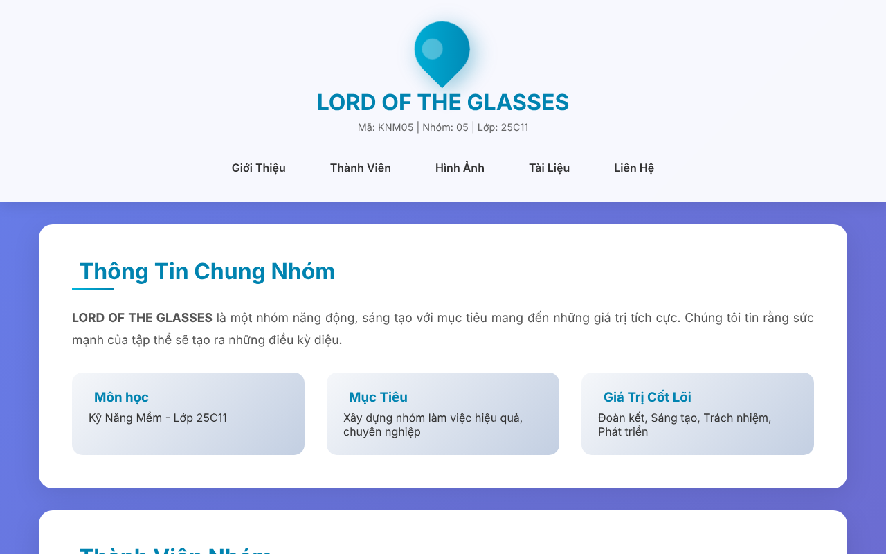

# KNM05 Team Website

A responsive one-page website for team **LORD OF THE GLASSES** (group 05,
class 25C11), built for the Soft Skills course at University of Science,
VNU-HCM. Plain HTML, CSS and JavaScript, no framework or build step.



## Sections

- **About**: team goals and core values
- **Members**: profile cards for the six members
- **Gallery**: photos from team meetings
- **Documents**: the team contract and group rules
- **Contact**

## Run

Open `index.html` in any browser. To serve it locally:

```bash
python -m http.server 8000   # then open http://localhost:8000
```

## Stack

HTML5, CSS3, vanilla JavaScript, Font Awesome icons.

---

*Website bài tập môn Kỹ Năng Mềm, lớp 25C11, nhóm 05. Mở `index.html` để xem.*
